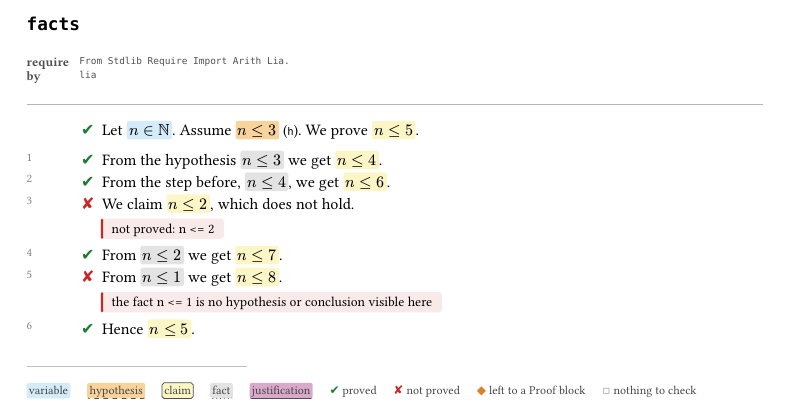

# Writing a proof in cyp: a tutorial

This tutorial is for a Rocq user who has never written a cyp text.  It
goes from a first proof to the Rocq commands, one small example at a time.
Each example is a file of [tutorial/](tutorial), shown here as it is, with
what cyp really prints for it.  The script
[tutorial/check.sh](tutorial/check.sh) runs cyp on every example again and
compares the results with the ones shown here ([section 11](TUTORIAL-2.md#11-keeping-the-tutorial-true)), so the
tutorial stays true.  The reference is [README.md](README.md); this page
does not replace it.

**In the browser.**  The whole tutorial is also one Rocq file to step
through, [tutorial/tutorial.v](tutorial/tutorial.v), with the same
sections: each proof is written as a `Cyp Lemma` (the Rocq form of a cyp
text), its Markdown form in a comment beside it.  Open it in rocq-web:
<https://thery.github.io/rocq-web/?example=cyp-tutorial&file=tutorial.v>,
and step through it (Alt+↓).  rocq-web cannot open a file at a given
line, so each section below says which section of tutorial.v to step to.

Contents:

1. [The idea](#1-the-idea)
2. [A first proof](#2-a-first-proof)
3. [The roles](#3-the-roles)
4. [Structure: steps, sub-steps, scope](#4-structure-steps-sub-steps-scope)
5. [Two syntaxes: lists and prose](#5-two-syntaxes-lists-and-prose)
6. [Justifications in depth](#6-justifications-in-depth)
7. [When something is wrong](TUTORIAL-2.md#7-when-something-is-wrong) (part 2)
8. [The Rocq side: Cyp File and Cyp Lemma](TUTORIAL-2.md#8-the-rocq-side-cyp-file-and-cyp-lemma)
9. [Writing a text from a Rocq proof: xtext](TUTORIAL-2.md#9-writing-a-text-from-a-rocq-proof-xtext)
10. [Reference card](TUTORIAL-2.md#10-reference-card)
11. [Keeping the tutorial true](TUTORIAL-2.md#11-keeping-the-tutorial-true)

## 1. The idea

A cyp proof is a text, written in Markdown, as you would write it on
paper.  Some formulas are *coloured*: a tag after the formula says what it
is, a variable, a hypothesis, what the step proves, or a fact it uses.
cyp reads only the coloured parts; every other word is for the human
reader.  From them, cyp turns each step of the text into a Rocq goal (a
*condition*) and tries to prove it.  It then writes the text back, with a
mark in front of each step: proved, or not.  When every step is proved,
the lemma is defined in Rocq.

The idea comes from *Colouring proofs: a lightweight approach to adding
formal structure to proofs* (UITP 2003): an author colours a proof
written in natural language, and the colours alone give its formal
structure.  cyp is that idea, with Markdown in place of the paper's XML
tags and Rocq as the checker.

## 2. A first proof

### The text

[tutorial/ch01_first.md](tutorial/ch01_first.md):

<!-- tutorial: ch01_first.md -->
```markdown
---
require: From Stdlib Require Import Arith Lia.
by: lia
---

# sqrt_le

Let `a b : nat`{.var}. Assume `a <= b`{.hyp} (h). We prove `Nat.sqrt a <= b /\ (0 < a -> 0 < b)`{.claim}.

- We have `Nat.sqrt a <= a`{.claim}.
- Assume `0 < a`{.hyp} (ha). Then `0 < b`{.claim}.
- Hence `Nat.sqrt a <= b /\ (0 < a -> 0 < b)`{.claim}.
```

It has three parts.

- **The header**, between the two lines `---`.  `require:` is the Rocq
  text run before the proof (the libraries it needs).  `by:` lists the
  tactics that cyp tries on each step.
- **The title**, `# sqrt_le`: the name of the lemma.
- **The statement and its proof.**  The paragraph after the title is the
  statement: `` `a b : nat`{.var} `` are variables, `` `a <= b`{.hyp} (h) ``
  a hypothesis named `h`, and the `{.claim}` is what is to be proved.
  Each list item after it is one step of the proof, with its own claim;
  step 2 also has its own hypothesis, `ha`.

The words "Let", "Assume", "We prove", "Then" mean nothing to cyp.  Only
the tags do.  This text says *what* each step claims, never *how* it is
proved: it has no justification.  We start there.

### 2.1 The conditions

Each step gives one **condition**: a Rocq goal whose conclusion is the
step's claim.  Its context is made of

- the variables and hypotheses in scope: those of the statement, and
  those of the step itself (`ha` for step 2);
- the claims of the steps before it, each as a hypothesis named after its
  step (`c1`, `c2`, ...).  A step with a hypothesis is seen from the steps
  after it as an implication: step 2 is `c2 : 0 < a -> 0 < b`.

The statement itself gives the last condition, number 0: its claim, from
the claims of all its steps.  `cyp --conditions` prints them, in the order
of the text, and tries none of them:

```sh
cyp --conditions ch01_first.md
```

<!-- tutorial: expected/cyp/ch01_first.conditions.out -->
```
cyp: sqrt_le
  a : nat
  b : nat
  h : a <= b
  ============================
  Nat.sqrt a <= a

  a : nat
  b : nat
  h : a <= b
  c1 : Nat.sqrt a <= a
  ha : 0 < a
  ============================
  0 < b

  a : nat
  b : nat
  h : a <= b
  c1 : Nat.sqrt a <= a
  c2 : 0 < a -> 0 < b
  ============================
  Nat.sqrt a <= b /\ (0 < a -> 0 < b)

  a : nat
  b : nat
  h : a <= b
  c1 : Nat.sqrt a <= a
  c2 : 0 < a -> 0 < b
  c3 : Nat.sqrt a <= b /\ (0 < a -> 0 < b)
  ============================
  Nat.sqrt a <= b /\ (0 < a -> 0 < b)

cyp: sqrt_le, 4 steps, 4 conditions

exit 0
```

Read them one by one:

- **step 1**: from `h`, prove `Nat.sqrt a <= a`;
- **step 2**: `ha` is in its context, because it is the step's own
  hypothesis; `c1` is there because step 1 comes before it;
- **step 3**: `ha` is gone (it holds only inside step 2), and step 2 is
  `c2 : 0 < a -> 0 < b`, the step seen from outside;
- **step 0**, the statement: its claim, from the claims of its three
  steps.

These are ordinary Rocq goals.  In Rocq, `#[bare] Cyp File` makes each of
them a goal of the Proof block that follows, named after its step (`?c1`,
`?c2`, `?c3`, `?c0`), and `Show c2` shows one.  Here they are proved by
hand, with ordinary tactics
([tutorial/ch01_first.v](tutorial/ch01_first.v); the module only keeps the
name `sqrt_le` free for the next run):

<!-- tutorial: ch01_first.v -->
```coq
Module Conditions.
#[bare] Cyp File "cyp-tutorial/ch01_first.md".
Proof.
  Show c1.
  Show c2.
  Show c3.
  Show c0.
  [c1]: apply Nat.sqrt_le_lin.
  [c2]: lia.
  [c3]: split; [lia | exact c2].
  [c0]: exact c3.
CypQed.
End Conditions.
```

Rocq prints the same four goals (`Show c2` gives `goal c2 (?c2) is:` and
the context above), then `cyp: sqrt_le proved`: the lemma is defined.

### 2.2 What cyp proves by itself

Without `#[bare]`, cyp tries to prove each condition itself: with the
rules of the text (none here), then the tactics of the header's `by:`
line (`lia`), then its own (`tauto`, `lia`, `nia`, `lra`), and a last
short search.  What it cannot prove is left.  The program `cyp` runs the
text this way:

```sh
cyp ch01_first.md
```

<!-- tutorial: expected/cyp/ch01_first.out -->
```
cyp: sqrt_le
Error:
cyp: 1 of 4 steps of sqrt_le not proved (1), see cyp-tutorial/ch01_first.checked.md
exit 1
```

(The line `exit 1` is the exit code, added by check.sh: 1 means the lemma
is not defined.)  It also writes `ch01_first.checked.md`, the text with a
mark in front of each step:

<!-- tutorial: expected/cyp/ch01_first.checked.md -->
```markdown
✅ Let `a b : nat`{.var}. Assume `a <= b`{.hyp} (h). We prove `Nat.sqrt a <= b /\ (0 < a -> 0 < b)`{.claim}.

- ❌ We have `Nat.sqrt a <= a`{.claim}.

  <details><summary>not proved: Nat.sqrt a <= a</summary></details>

- ✅ Assume `0 < a`{.hyp} (ha). Then `0 < b`{.claim}.
- ✅ Hence `Nat.sqrt a <= b /\ (0 < a -> 0 < b)`{.claim}.
```

`lia` proves the conditions of steps 2, 3 and 0, but knows nothing of
`Nat.sqrt`: step 1 is ❌.  The marks of the checked Markdown are ✅
(proved), ❌ (not proved, or an error), 🔶 (left to a Proof block) and ▫️
(a remark: nothing to check).  Under a ❌ or a 🔶, a folded block gives
the reason.

In Rocq, `Cyp File` (without `#[bare]`) leaves only that condition to the
Proof block:

<!-- tutorial: ch01_first.v -->
```coq
Module Tried.
Cyp File "cyp-tutorial/ch01_first.md".
Proof.
  Show.
  [c1]: apply Nat.sqrt_le_lin.
CypQed.
End Tried.
```

<!-- tutorial: expected/rocq/ch01_first.out -->
```
cyp: sqrt_le
  ✅ 0
  ✅ 2
  ✅ 3
cyp: sqrt_le, 4 steps, 1 condition(s) left for the Proof block: 1
  🔶 condition 1: Nat.sqrt a <= a
1 goal (?c1)
  
  a, b : nat
  h : a <= b
  ============================
  Nat.sqrt a <= a
cyp: sqrt_le proved
```

### 2.3 Telling cyp how: justifications

A **justification** `*X*{.just}` says how to prove a step's condition: a
lemma, a hypothesis, an earlier step, or a declared word such as a tactic
(section 3 and [section 6](#6-justifications-in-depth)).  In
[tutorial/ch01_first_just.md](tutorial/ch01_first_just.md), step 1 names
the lemma that proves it:

<!-- tutorial: ch01_first_just.md -->
```markdown
- By the lemma *Nat.sqrt_le_lin*{.just}, we have `Nat.sqrt a <= a`{.claim}.
```

The condition of step 1 is the same goal as before; cyp now hands the
lemma to its tactics, and the goal is closed:

<!-- tutorial: expected/cyp/ch01_first_just.checked.md -->
```markdown
- ✅ By the lemma *Nat.sqrt_le_lin*{.just}, we have `Nat.sqrt a <= a`{.claim}.
- ✅ Assume `0 < a`{.hyp} (ha). Then `0 < b`{.claim}.
- ✅ Hence `Nat.sqrt a <= b /\ (0 < a -> 0 < b)`{.claim}.
```

<!-- tutorial: expected/cyp/ch01_first_just.out -->
```
cyp: sqrt_le_just
cyp: sqrt_le_just proved, 4 steps
exit 0
```

Every step is proved, so the lemma is defined, with no Proof block.  This
is the whole method of cyp: the text gives the conditions; cyp proves
what it can; justifications help it where it cannot; what is left is
yours, in a Proof block.

### The PDF and the web page

[../prooftext/pdf.sh](../prooftext/pdf.sh) makes a PDF of a checked text
with Typst (`--html` for a web page):

```sh
../prooftext/pdf.sh ch01_first.checked.md     # writes ch01_first.checked.pdf
```

The tags are not shown; each role has its colour, the formulas are
printed as mathematics, and each step has its number in the margin and
its mark: ✔ proved, ✘ not proved, ◆ left to a Proof block (or an open
goal), ▫ a remark.  The PDF of example 03 (section 3) looks like this:



In the browser: step to section 2 of [tutorial.v](tutorial/tutorial.v),
where the same text is a `Cyp Lemma`, run bare, then tried, then
justified.  Change a formula there, step again, and see which condition
changes.

## 3. The roles

A tag is written right after a formula, between braces: `` `F`{.claim} ``.
This section shows each role on a small example.

### Variables, hypotheses, claims, remarks

[tutorial/ch02_roles.md](tutorial/ch02_roles.md):

<!-- tutorial: ch02_roles.md -->
```markdown
---
require: From Stdlib Require Import Arith Lia.
by: lia
---

# roles

Let `a b : nat`{.var} and `s := a + b`{.var}. Assume `a <= b`{.hyp} (hab) and `b <= 10`{.hyp}. We prove `s <= 20`{.claim}.

- This line is a remark: it has no tag, so cyp shows it and checks nothing.
- By *hab*{.just} and *H1*{.just} we have `a <= 10`{.claim} (ha).
- From `a <= 10`{.fact} and `b <= 10`{.fact} we get `a + b <= 20`{.claim}.
- As `s` is `a + b`, we have `s <= 20`{.claim}.
```

- **Variable**, `` `a b : nat`{.var} ``: one or more names and a type, as
  after `forall` in Rocq.  `` `s := a + b`{.var} `` is a local
  definition: in the step that proves `s <= 20`, `s` is `a + b`.
- **Hypothesis**, `` `a <= b`{.hyp} (hab) ``: a formula assumed, with its
  name in brackets after it.  Without a name, cyp names it `H1`, `H2`,
  ...: here `b <= 10` is `H1`.
- **Claim**, `` `a <= 10`{.claim} (ha) ``: what the step proves, its
  *conclusion*.  A step has exactly one.  A name after it, `(ha)`, lets
  later steps refer to it.
- **Remark**: an item with no tag at all.  cyp shows it and checks
  nothing.

The result:

<!-- tutorial: expected/cyp/ch02_roles.checked.md -->
```markdown
# roles

✅ Let `a b : nat`{.var} and `s := a + b`{.var}. Assume `a <= b`{.hyp} (hab) and `b <= 10`{.hyp}. We prove `s <= 20`{.claim}.

- ▫️ This line is a remark: it has no tag, so cyp shows it and checks nothing.
- ✅ By *hab*{.just} and *H1*{.just} we have `a <= 10`{.claim} (ha).
- ✅ From `a <= 10`{.fact} and `b <= 10`{.fact} we get `a + b <= 20`{.claim}.
- ✅ As `s` is `a + b`, we have `s <= 20`{.claim}.
```

In the browser: step to section 3 of [tutorial.v](tutorial/tutorial.v).

### Claim or fact?

Both are formulas the step talks about.  The difference is who proves
them.

- A **claim** `` `C`{.claim} `` is proved *here*: it is the conclusion of
  this step, and cyp tries to prove it.
- A **fact** `` `F`{.fact} `` is *used* here: it must already be known.
  cyp does not prove it.  It checks that it is a hypothesis, or the claim
  of a step that this step can see (up to conversion: `n < 5` and
  `S n <= 5` are the same fact), and puts it first for the proof of the
  step.  A fact that is neither is an error of the step.

[tutorial/ch03_facts.md](tutorial/ch03_facts.md):

<!-- tutorial: ch03_facts.md -->
```markdown
---
require: From Stdlib Require Import Arith Lia.
by: lia
---

# facts

Let `n : nat`{.var}. Assume `n <= 3`{.hyp} (h). We prove `n <= 5`{.claim}.

- From the hypothesis `n <= 3`{.fact} we get `n <= 4`{.claim}.
- From the step before, `n <= 4`{.fact}, we get `n <= 6`{.claim}.
- We claim `n <= 2`{.claim}, which does not hold.
- From `n <= 2`{.fact} we get `n <= 7`{.claim}.
- From `n <= 1`{.fact} we get `n <= 8`{.claim}.
- Hence `n <= 5`{.claim}.
```

<!-- tutorial: expected/cyp/ch03_facts.checked.md -->
```markdown
# facts

✅ Let `n : nat`{.var}. Assume `n <= 3`{.hyp} (h). We prove `n <= 5`{.claim}.

- ✅ From the hypothesis `n <= 3`{.fact} we get `n <= 4`{.claim}.
- ✅ From the step before, `n <= 4`{.fact}, we get `n <= 6`{.claim}.
- ❌ We claim `n <= 2`{.claim}, which does not hold.

  <details><summary>not proved: n <= 2</summary></details>

- ✅ From `n <= 2`{.fact} we get `n <= 7`{.claim}.
- ❌ From `n <= 1`{.fact} we get `n <= 8`{.claim}.

  <details><summary>the fact n <= 1 is no hypothesis or conclusion visible here</summary></details>

- ✅ Hence `n <= 5`{.claim}.
```

Read it step by step:

- step 1 uses the hypothesis as a fact; step 2 uses the claim of step 1;
- step 3 claims `n <= 2`, which does not follow: ❌, "not proved";
- **step 4 uses the failed claim of step 3 as a fact, and is ✅.**  This is
  not a bug.  A fact only has to be *known*: the claim of step 3 is known
  to every later step, whether step 3 was proved or not, as on paper.
  What is proved is "if step 3 holds, then step 4 holds".  The lemma is
  not defined all the same, because step 3 is ❌.  So, when a text has a
  ❌, look at it first: the steps after it may lean on it;
- step 5 uses `n <= 1` as a fact, but nothing gives `n <= 1`: an error,
  and the step is not tried.

The program prints

<!-- tutorial: expected/cyp/ch03_facts.out -->
```
cyp: facts
Error:
cyp: 2 of 7 steps of facts not proved (3, 5), see cyp-tutorial/ch03_facts.checked.md
exit 1
```

In the browser: step to section 3 of [tutorial.v](tutorial/tutorial.v).

### Justifications

`*X*{.just}` (an emphasised name with the tag `just`) names something the
step uses, where the sentence mentions it: it tells cyp how to prove the
step's condition (section 2.3).  A step may have several.  X may be a
hypothesis, an earlier step, a lemma, or a word such as a tactic.
[tutorial/ch04_justifications.md](tutorial/ch04_justifications.md):

<!-- tutorial: ch04_justifications.md -->
```markdown
---
require: From Stdlib Require Import Arith Lia.
---

# justifications

Let `P Q : nat -> Prop`{.var} and `n : nat`{.var}. Assume `forall m, m <= n -> P m`{.hyp} (hp) and `forall m, P m -> Q m`{.hyp} (hq). We prove `Q (n + 0) /\ n * 1 = n`{.claim}.

- By *hp*{.just} we have `n <= n -> P n`{.claim}.
- So, by the step before (*c1*{.just}), `P n`{.claim} (pn).
- Applying *hq*{.just} to *pn*{.just}, we have `Q n`{.claim} (qn).
- By the lemma *Nat.add_0_r*{.just}, `n + 0 = n`{.claim} (e).
- With *e*{.just} and *qn*{.just}, we get `Q (n + 0)`{.claim} (qn0).
- By the tactic *lia*{.just}, `n * 1 = n`{.claim} (m1).
- By *qn0*{.just} and *m1*{.just}, we conclude `Q (n + 0) /\ n * 1 = n`{.claim}.
```

- *hp*{.just}, *hq*{.just}: hypotheses of the statement.
- *c1*{.just}: step 1.  A step with no name is called `c` and its number:
  `c1`, `c2`, and `c2_1` for the first sub-step of step 2.
- *pn*{.just}, *e*{.just}, *qn0*{.just}: earlier steps, by the names the
  text gave them.
- *Nat.add_0_r*{.just}: a lemma of the library.
- *lia*{.just}: a tactic word.  A word chooses the method; the other
  names are handed to it (section 6).

Every step is ✅ (the output is in
[tutorial/expected/cyp/](tutorial/expected/cyp)).  In the browser: step to section 3 of [tutorial.v](tutorial/tutorial.v).

### Case analysis and induction

Two justification words are methods: `*match*{.just}`, a case analysis,
and `*induction*{.just}`, an induction.  They act on the hypotheses or
variables the step names.  The name of an inductive type may come with
them (`*ex*{.just}`, `*list*{.just}`): it says the type of the object.
The sub-steps are the cases.

[tutorial/ch05_match.md](tutorial/ch05_match.md), a case analysis on a
hypothesis `exists k, ...`:

<!-- tutorial: ch05_match.md -->
```markdown
---
require: From Stdlib Require Import Arith Lia.
by: lia
---

# even_plus_two

Let `n : nat`{.var}. Assume `exists k, n = 2 * k`{.hyp} (h). We prove `exists k, n + 2 = 2 * k`{.claim}.

- By case analysis (*match*{.just}) on *h*{.just}, of type *ex*{.just}, we prove `exists k, n + 2 = 2 * k`{.claim}:
  - Let `k : nat`{.var} and assume `n = 2 * k`{.hyp} (hk).
    - Then `n + 2 = 2 * (k + 1)`{.claim} (e), by *hk*{.just}.

    So `exists k, n + 2 = 2 * k`{.claim}, with `k + 1` as the witness (*ex_intro*{.just}, *e*{.just}).
```

The one case has a variable `k` and a hypothesis `hk`, and its claim is in
its last paragraph (the *closing paragraph*, section 4).  All four steps
are ✅.  In the browser: step to section 3 of [tutorial.v](tutorial/tutorial.v).

[tutorial/ch06_induction.md](tutorial/ch06_induction.md), an induction on
a list:

<!-- tutorial: ch06_induction.md -->
```markdown
---
require: From Stdlib Require Import List Lia. Import ListNotations.
by: easy | lia
---

# length_app

Let `A : Type`{.var} and `l m : list A`{.var}. We prove `length (l ++ m) = length l + length m`{.claim}.

- By *induction*{.just} on *l*{.just}, we prove `length (l ++ m) = length l + length m`{.claim}:
  - For the empty list, `length ([] ++ m) = length [] + length m`{.claim}, by computation (*easy*{.just}).
  - Let `x : A`{.var} and `l' : list A`{.var}; assume `length (l' ++ m) = length l' + length m`{.hyp} (IH). We prove `length ((x :: l') ++ m) = length (x :: l') + length m`{.claim}:
    - It is `S (length (l' ++ m)) = S (length l' + length m)`{.claim}, by *IH*{.just}.
```

The second case states the induction hypothesis itself, as a hypothesis
`(IH)`; cyp checks that the cases given prove the step.  All five steps
are ✅.  In the browser: step to section 3 of [tutorial.v](tutorial/tutorial.v).

### Open goals

A step whose conclusion is tagged `` `G`{.goal} `` instead of
`` `G`{.claim} `` is an **open goal**: the author has not proved it yet.
cyp does not try it, even when it is easy, and the steps after it use it
as any claim.  It is marked 🔶; [section 8](TUTORIAL-2.md#8-the-rocq-side-cyp-file-and-cyp-lemma) shows how to prove it in a Proof
block.

## 4. Structure: steps, sub-steps, scope

The rules are those of the 2003 paper:

- **One conclusion per step.**  Each step (a list item, or a span or div,
  section 5) has exactly one `{.claim}` (or `{.goal}`) in its own text.
- **Sub-steps.**  The sub-items of an item are its sub-steps.  The
  conclusion of a step follows from its sub-steps.  There are no words
  like "it suffices to prove": going backwards is nesting.
- **Scope.**  The variables and hypotheses of a step hold in that step
  and in its sub-steps, nowhere else.
- **Earlier steps.**  A step can use every step before it in its list, and
  the steps before each step around it.
- **Seen from outside**, a step with variables V, hypotheses H and
  conclusion C is the formula ∀ V, H → C, whatever its proof.
- **The closing paragraph.**  A paragraph after the sub-items, indented
  as the text of the item, belongs to the item.  It lets a step give its
  conclusion after its sub-steps ("So, ..."): the forward style.

[tutorial/ch07_structure.md](tutorial/ch07_structure.md):

<!-- tutorial: ch07_structure.md -->
```markdown
---
by: tauto | auto
---

# structure

Let `P Q R : Prop`{.var}. Assume `P -> Q`{.hyp} (pq) and `Q -> R`{.hyp} (qr). We prove `P -> R /\ Q`{.claim}.

- Assume `P`{.hyp} (p).  Then:
  - By *pq*{.just} and *p*{.just}, we have `Q`{.claim} (q).
  - By *qr*{.just} and *q*{.just}, we have `R`{.claim} (r).

  So, with *r*{.just} and *q*{.just}, we have `R /\ Q`{.claim}.
- Hence `P -> R /\ Q`{.claim}.
```

Step 1 assumes `P`; its two sub-steps use `p`; its conclusion `R /\ Q` is
in the closing paragraph.  Step 2 does not see `p`, `q` or `r`: it sees
step 1 from outside, as `P -> R /\ Q`.

**The conditions** (section 2.1).  `cyp --conditions` prints the goal of each step, in
the order of the text, and tries none of them (`#[bare] CypFile` in
Rocq).  Each goal is the step's conclusion, below the variables,
hypotheses and earlier steps it can see:

<!-- tutorial: expected/cyp/ch07_structure.conditions.out -->
```
cyp: structure
  P : Prop
  Q : Prop
  R : Prop
  pq : P -> Q
  qr : Q -> R
  p : P
  ============================
  Q

  P : Prop
  Q : Prop
  R : Prop
  pq : P -> Q
  qr : Q -> R
  p : P
  q : Q
  ============================
  R

  P : Prop
  Q : Prop
  R : Prop
  pq : P -> Q
  qr : Q -> R
  p : P
  q : Q
  r : R
  ============================
  R /\ Q

  P : Prop
  Q : Prop
  R : Prop
  pq : P -> Q
  qr : Q -> R
  c1 : P -> R /\ Q
  ============================
  P -> R /\ Q

  P : Prop
  Q : Prop
  R : Prop
  pq : P -> Q
  qr : Q -> R
  c1 : P -> R /\ Q
  c2 : P -> R /\ Q
  ============================
  P -> R /\ Q

cyp: structure, 5 steps, 5 conditions

exit 0
```

The goals are those of steps 1.1, 1.2, 1, 2, and last 0, the statement,
proved from its steps.  In the goal of step 2, step 1 is the hypothesis
`c1 : P -> R /\ Q`.  The text is a *verification condition generator*:
each step gives one condition, and cyp proves each with the step's
justifications and facts, or its default tactics.  All five are ✅.

In the browser: step to section 4 of [tutorial.v](tutorial/tutorial.v).

## 5. Two syntaxes: lists and prose

A step may also be written inside a paragraph:

- a **span** `[ ... ]{.p}` is a step; spans nest;
- a **div**, the lines between `::: p` and `:::`, is a step of several
  paragraphs.

The marks `[`, `]{.p}` and `:::` are not shown in the PDF.  A part of the
text belongs to the innermost step around it.  Lists, spans and divs give
the same tree, and may be mixed at any depth.

The same proof both ways.  With lists,
[tutorial/ch08_structured.md](tutorial/ch08_structured.md):

<!-- tutorial: ch08_structured.md -->
```markdown
---
by: tauto
---

# praeclarum

Let `x y z t : Prop`{.var}. If `x -> z`{.hyp} and `y -> t`{.hyp} then `x /\ y -> z /\ t`{.claim}.

- Suppose `x /\ y`{.hyp}.
  - We get `z`{.claim} by `x -> z`{.fact}, since
    - we have `x`{.claim}.
  - We get `t`{.claim} by `y -> t`{.fact}, since
    - we have `y`{.claim}.

  Altogether we have `z /\ t`{.claim}.
```

In prose, [tutorial/ch08_free.md](tutorial/ch08_free.md):

<!-- tutorial: ch08_free.md -->
```markdown
---
by: tauto
---

# praeclarum_free

Let `x y z t : Prop`{.var}. If `x -> z`{.hyp} and `y -> t`{.hyp} then `x /\ y -> z /\ t`{.claim}.

::: p
Suppose `x /\ y`{.hyp}.

[[We have `x`{.claim}]{.p}, so by `x -> z`{.fact} we get `z`{.claim}.]{.p}
[[We have `y`{.claim}]{.p}, so by `y -> t`{.fact} we get `t`{.claim}.]{.p}

Altogether we have `z /\ t`{.claim}.
:::
```

Both have six steps, all ✅.  In the checked text, the mark of a span is
put just inside it:

<!-- tutorial: expected/cyp/ch08_free.checked.md -->
```markdown
::: p
✅ Suppose `x /\ y`{.hyp}.

[✅ [✅ We have `x`{.claim}]{.p}, so by `x -> z`{.fact} we get `z`{.claim}.]{.p}
[✅ [✅ We have `y`{.claim}]{.p}, so by `y -> t`{.fact} we get `t`{.claim}.]{.p}

Altogether we have `z /\ t`{.claim}.
:::
```

Which one to use?  Lists make the structure visible at a glance, and
suit a proof written for cyp.  Prose keeps the paragraphs of a paper as
they are: you colour an existing text without rewriting it.  This is how
the 2003 paper coloured its proofs.

In the browser: this one needs Markdown files; section 5 of
[tutorial.v](tutorial/tutorial.v) only says so.

## 6. Justifications in depth

### How a name is looked up

A justification `*X*{.just}` is looked up in this order:

1. `match` and `induction`, the two methods (section 3);
2. a name of the text in scope: a hypothesis, a step (`c2`, or its own
   name), a variable;
3. a word declared with `CypJustification` (below);
4. a lemma (possibly qualified, `Nat.add_comm`);
5. otherwise, an error of the step: "X names nothing known" ([section 7](TUTORIAL-2.md#7-when-something-is-wrong)).

What happens then:

- a **declared word** chooses the method; several are tried in turn;
- the **other names** (hypotheses, steps, lemmas) are handed to the
  method: put first in the context, a lemma added to it;
- with **no declared word**, the names are applied one after the other,
  like a lemma; when that fails, the default tactics run with the names
  given;
- the **types** with `match` and `induction` (`*or*{.just}`) only say the
  type of the object; a type alone justifies nothing (an error).

A justification is a name, never tactic code: `*by lia*{.just}` or
`*interval with (i_prec 100)*{.just}` are errors.  To use such a tactic,
give it a name, as below.

### Declaring a word

What a word means is written in the proof's files, with the command
`CypJustification`:

- `CypJustification "word" := tac.` — the word runs the Ltac tactic `tac`;
- `CypJustification "word" := rules.` — the word means the Elpi rules
  `named "word" ...`, and only them.

Rules are useful when the method depends on the shape of the goal: a rule
says "on a goal that looks like this, apply that lemma".  The declarations
go in a rule file named by the header's `rules:` line.
[tutorial/ch09_words_rules.v](tutorial/ch09_words_rules.v):

<!-- tutorial: ch09_words_rules.v -->
```coq
(* The words of ch09_words.md, read by the program cyp from its header:
   "rules: ch09_words_rules.v". *)
From Stdlib Require Import Arith Lia.
From CypV Require Import Cyp.

Ltac arith_check := lia.
CypJustification "arithmetic" := arith_check.

Elpi Accumulate cyp.db lp:{{
  named "monotonicity" {{ (_ * _ <= _ * _)%nat }} (apply {{ Nat.mul_le_mono_r }}).
  named "monotonicity" {{ (_ * _ <= _ * _)%nat }} (apply {{ Nat.mul_le_mono_l }}).
}}.
CypJustification "monotonicity" := rules.
```

The two rules say: on a goal `_ * _ <= _ * _`, apply
`Nat.mul_le_mono_r` (or `_l`), and prove its premises.
[tutorial/ch09_words.md](tutorial/ch09_words.md) uses both words:

<!-- tutorial: ch09_words.md -->
```markdown
---
require: From Stdlib Require Import Arith Lia.
rules: ch09_words_rules.v
---

# words

Let `a b c d : nat`{.var}. If `a <= b`{.hyp} (hab) and `c <= d`{.hyp} (hcd) then `a * c <= b * d`{.claim}.

- By *monotonicity*{.just}, `a * c <= b * c`{.claim} (s1).
- Again by *monotonicity*{.just}, `b * c <= b * d`{.claim} (s2).
- By *arithmetic*{.just}, `a * c <= b * d`{.claim}.
- By *monotonicity*{.just}, `a + c <= b + d`{.claim}: no rule fits a sum.
```

<!-- tutorial: expected/cyp/ch09_words.checked.md -->
```markdown
- ✅ By *monotonicity*{.just}, `a * c <= b * c`{.claim} (s1).
- ✅ Again by *monotonicity*{.just}, `b * c <= b * d`{.claim} (s2).
- ✅ By *arithmetic*{.just}, `a * c <= b * d`{.claim}.
- ❌ By *monotonicity*{.just}, `a + c <= b + d`{.claim}: no rule fits a sum.

  <details><summary>not proved: a + c <= b + d</summary></details>
```

Step 4 is true (lia would prove it), but the text says *why* it holds,
monotonicity, and no rule of that name fits a sum: a word declared as
rules is the reason of the step, and nothing else is tried.  This is on
purpose: Rocq checks the reason the text gives, not just the claim.

The tactics every text may name (`lia`, `lra`, `nia`, `nra`, `ring`,
`field`, `tauto`, `auto`, `easy`, `reflexivity`, `assumption`,
`congruence`, `firstorder`) are declared in the same way at the end of
[vernac/Cyp.v](vernac/Cyp.v).  A word is declared once.  A name of the
text hides a declared word, which hides a lemma of the same name.

In the browser: step to section 6 of [tutorial.v](tutorial/tutorial.v),
where the words are declared in the file itself.

### When no justification is given

A step with no justification is tried with, in order: the rules of the
rule files, the tactics of the header's `by:` line, and cyp's own (`tauto`,
`lia`, `nia`, `lra`), the facts first.  Then comes the **gap tactic**, a
last, short and bounded search ([vernac/Gaps.v](vernac/Gaps.v)): it takes
the goal and hypotheses apart, tries a case analysis on a variable or an
induction, and a few constructors.  The header line `gaps: off` turns it
off.

[tutorial/ch10_defaults.md](tutorial/ch10_defaults.md):

<!-- tutorial: ch10_defaults.md -->
```markdown
---
require: From Stdlib Require Import Arith Lia.
by: lia
---

# defaults

Let `o : option nat`{.var} and `n : nat`{.var}. Assume `n < 3`{.hyp}. We prove `option_map (fun x => x) o = o /\ n <= 2`{.claim}.

- We have `n <= 2`{.claim}.
- Whether `o` is `None` or `Some x`, the map changes nothing, so `option_map (fun x => x) o = o`{.claim}.
```

Step 1 is proved by `lia`, from the `by:` line.  Step 2 needs a case
analysis on `o`, which the gap tactic finds: all three steps are ✅.
[tutorial/ch10_no_gaps.md](tutorial/ch10_no_gaps.md) is the same text
with `gaps: off` in its header, and step 2 is no longer proved:

<!-- tutorial: expected/cyp/ch10_no_gaps.checked.md -->
```markdown
- ✅ We have `n <= 2`{.claim}.
- ❌ Whether `o` is `None` or `Some x`, the map changes nothing, so `option_map (fun x => x) o = o`{.claim}.

  <details><summary>not proved: option_map (fun x : nat => x) o = o</summary></details>
```

The gap tactic makes short texts pass, but it says nothing to the reader.
A justification (*match*{.just} on *o*{.just}) says how the step holds.

In the browser: step to section 6 of [tutorial.v](tutorial/tutorial.v).

The tutorial goes on in [part 2](TUTORIAL-2.md): when something is wrong,
the Rocq commands, xtext, and a reference card.
